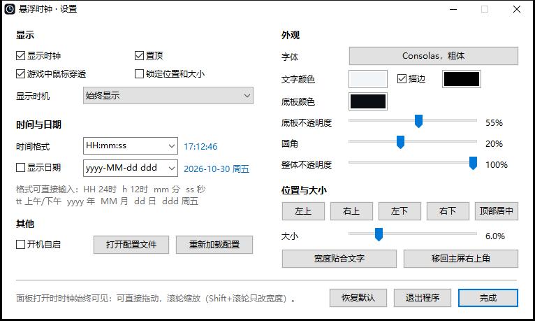

# 悬浮时钟 ClockOverlay

C + 纯 Win32 编写，体积 68 KB，不需要安装任何运行库。它只读取系统时间、显示一个独立窗口：
不注入、不 Hook、不读任何进程的内存、**不注册任何键盘热键或键盘钩子**，也不读取进程名或窗口标题。

**下载**：到 [Releases](https://github.com/just-liuyi/clock-overlay/releases/latest) 下载 `ClockOverlay.exe`，双击运行即可（SHA256 校验值同页提供）。
自行编译时，产物在 `out\ClockOverlay.exe`。

## 快速上手

1. 双击 `ClockOverlay.exe`。第一次启动会自动打开**设置面板**。
2. 面板打开期间，时钟带蓝色边框，可以直接**拖动**摆位置、用**滚轮**调大小；其余设置都在面板里改，改动即时生效。
3. 点 **完成**（或关闭面板）后时钟回到**游戏模式**：鼠标会穿透它、它也不抢焦点，设置自动保存。



## 打开设置面板的方法

| 方法 | 说明 |
|---|---|
| 点击托盘图标 | 左键、右键都行（Win11 可能把图标折叠在任务栏的 `^` 里） |
| 再次运行 `ClockOverlay.exe` | 已运行的那个会显示时钟、拉回屏幕内并打开面板。**这条一定有效** |
| 双击时钟 | 仅在关闭了“游戏中鼠标穿透”时可用 |

## 面板里能改什么

- **显示**：显示时钟、置顶、游戏中鼠标穿透、锁定位置和大小、显示时机（始终 / 仅全屏程序在前台时）
- **时间与日期**：时间格式、是否显示日期、日期格式。可以选预设，也可以直接输入格式串，右边实时预览，格式非法时显示红字“格式无效”且不会生效
- **外观**：字体（系统字体对话框）、文字颜色、描边及颜色、底板颜色、底板不透明度（0% 时只显示文字）、圆角、整体不透明度（最低 20%）
- **位置与大小**：四个角、顶部居中、大小滑块（窗口高度占屏幕高度的 2%–20%）、宽度贴合文字、移回主屏右上角
- **其他**：开机自启、打开配置文件、重新加载配置、恢复默认、退出程序

锁定后边框变成橙色，拖动、滚轮、位置按钮和大小滑块都会停用。

## 记忆系统

- 配置文件：`%APPDATA%\ClockOverlay\ClockOverlay.ini`（UTF-16 编码，带注释，也可以手改）
- **便携模式**：在 exe 同目录放一个名为 `portable` 的空文件，配置就存在 exe 旁边
- 位置按“显示器 + 锚定角 + 比例偏移”保存。游戏切换分辨率后，时钟按比例回到相同的相对位置
- 原来所在的副屏拔掉后，时钟回到主屏；重新接上后回到原来的屏幕
- 先写临时文件再整体替换，写到一半被强制结束也不会损坏配置
- 某一项写坏了只丢弃那一项，其余设置照旧
- 旧版配置里的热键项会被忽略

## 命令行

| 参数 | 作用 |
|---|---|
| （无） | 启动；已在运行时，等同于打开设置面板 |
| `/exit` | 关闭正在运行的实例 |

## 编译

需要 MinGW-w64（`winget install BrechtSanders.WinLibs.POSIX.UCRT`），然后运行：

```
pwsh -ExecutionPolicy Bypass -File build.ps1
```

## 已知限制

- **真独占全屏**的游戏（关闭了“全屏优化”，或老的 DX9 / Vulkan 游戏）会独占显卡输出，任何独立窗口都显示不上去，
  Discord、OBS 的普通窗口也一样。遇到这种情况，先去游戏 exe 的属性 → 兼容性里检查
  “禁用全屏优化”是否被勾选，勾了就取消。
- 打开设置面板会让游戏失去焦点（面板是普通窗口）。建议在游戏外调好，游戏中只用来看时间。
